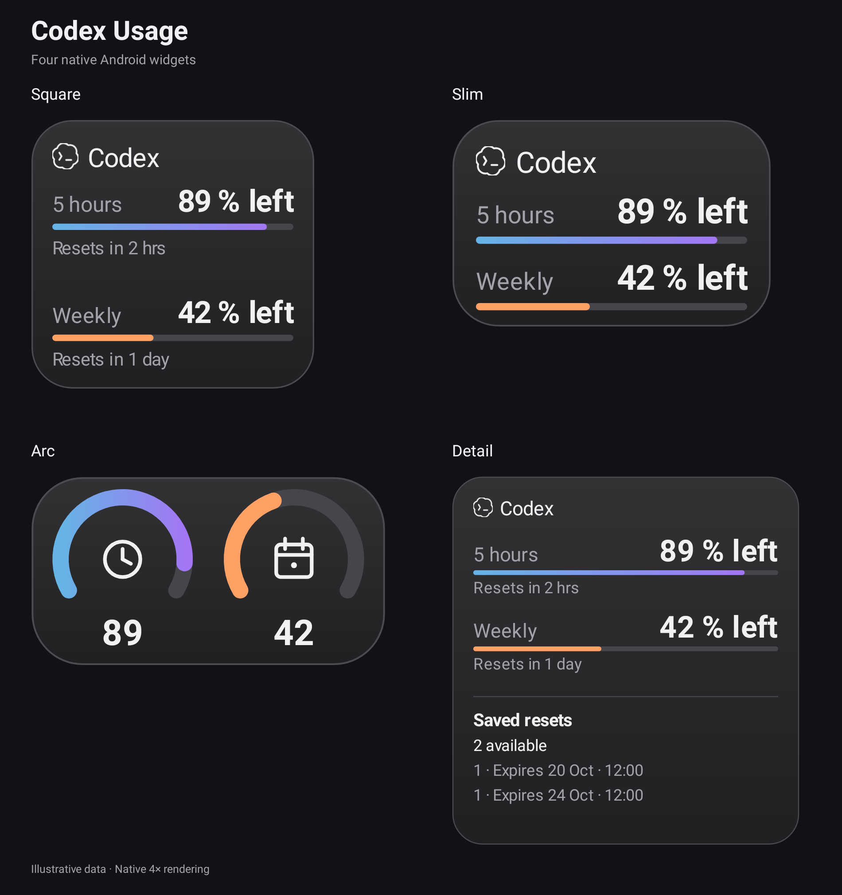

<div align="center">

# Codex Usage

Native Android widgets for your Codex or Claude plan limits.

[](https://github.com/jioryII/Codex-Usage-Android/raw/refs/heads/main/downloads/codex-usage-claude.apk)

**v1.4.0 · Android 8+ · No API key · No analytics**

</div>



*Illustrative usage data. Images rendered at 4× resolution.*

## Install

1. Download and install the APK above. This build uses a different signing key from the previously published 1.3.1 APK. Android cannot install it over that version: uninstalling the old app first removes its local session and widgets, which must then be set up again.
2. Open **Codex Usage → Continue with ChatGPT → Copy code and open OpenAI**. Sign in, paste the code, authorize, then return.
3. Select **Add widget** and choose a layout. Remove and re-add an existing widget to apply the updated size limits.

English is the initial language. Spanish remains available through **EN/ES**.

### Claude

Choose **Continue with Claude → Open Claude authorization**, authorize in the browser, then paste the complete returned `code#state` into the app and select **Finish connection**. Claude shows the remaining five-hour and overall weekly quota in orange in all four layouts. Unknown or expired windows remain unknown. Saved-reset reminders are only available for Codex.

The app uses one active account at a time; sign out to change providers. Existing Codex sessions remain compatible. Claude uses the public Claude Code OAuth client with PKCE and the `user:profile` scope. This is unofficial compatibility and has not been verified with a live account. The download above includes Claude support. The previous [Codex-only 1.3.1 APK](downloads/codex-usage.apk) is retained separately.

## Layouts

| Widget | Content |
| --- | --- |
| **Square** | Usage bars, remaining percentages and reset countdowns. |
| **Slim** | Two usage bars and percentages, without countdowns. |
| **Arc** | Compact pill with clock/calendar indicators and numeric values without `%`. |
| **Detail** | Compact square card with usage, saved resets and available expiry dates. |

All layouts share one dark finish. Codex remaining quota uses blue-to-purple at 75–100%, blue at 50–74%, orange at 25–49% and red below 25%. Claude quota uses orange throughout. Icon-sized variants are removed; the launcher controls the final grid dimensions.

## Background updates

Updates target 15-minute intervals and skip routine requests while the phone is locked or idle. Repeated requests are grouped and server cooldowns are respected. Optional expiry reminders revalidate available resets; Android may delay delivery.

## About

Independent, unofficial app. Usage relies on ChatGPT and Claude interfaces that may change. Credentials stay encrypted on the device. No automatic reset redemption. Live account access and Samsung/One UI behavior have not been verified in this development environment.

## Build

JDK 21, Android SDK 36 and Build Tools 36.0.0:

```sh
./gradlew assembleDebug
./gradlew testDebugUnitTest lintDebug assembleDebugAndroidTest
```

[Technical notes](docs/DEVELOPMENT.md) · [Validation](docs/VALIDATION.md) · [Third-party notices](THIRD_PARTY_NOTICES.md)
